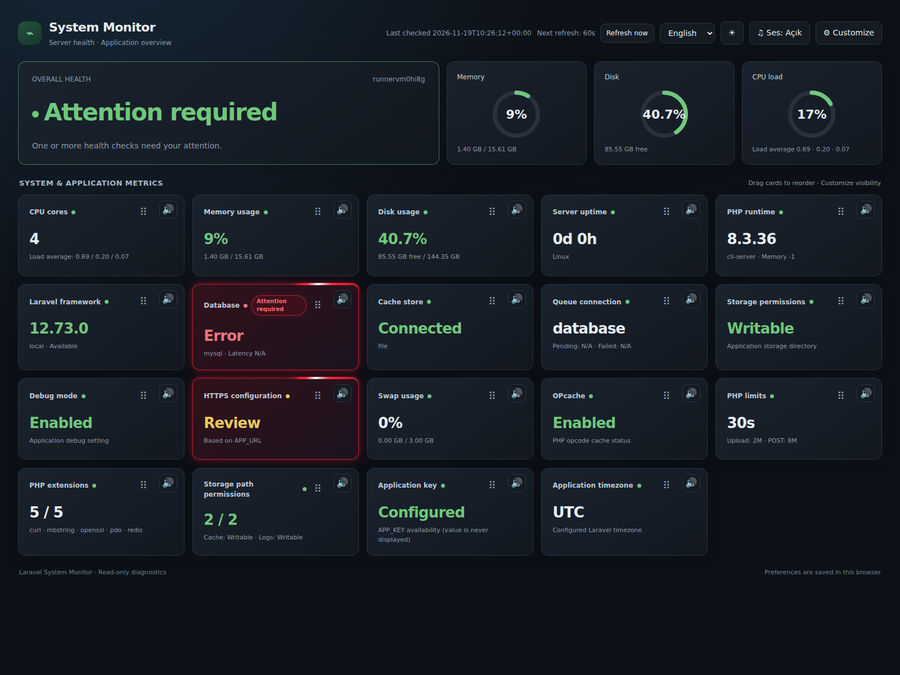

# Laravel System Monitor

A lightweight, framework-native monitoring dashboard for Laravel. Get a quick view of server resources, runtime services and application health — without requiring Redis, Horizon, S3, Cloudflare R2 or any other optional infrastructure.

<p align="center">
  
</p>

<p align="center">
  <a href="https://github.com/mertaydin/laravel-system-monitor/actions/workflows/tests.yml"></a>
  <a href="https://packagist.org/packages/mertaydin/laravel-system-monitor"></a>
  <a href="https://packagist.org/packages/mertaydin/laravel-system-monitor"></a>
  <a href="https://packagist.org/packages/mertaydin/laravel-system-monitor"></a>
</p>

## Features

- **Server overview:** hostname, OS family, uptime, CPU core count and load average.
- **Memory and disk:** RAM, swap and application filesystem usage where the host exposes the required information.
- **PHP runtime:** PHP version, SAPI, memory and upload limits, OPcache and selected extension availability.
- **Laravel application:** framework version, environment, maintenance mode and storage permissions.
- **Database:** connection status, driver and a lightweight `SELECT 1` latency check.
- **Cache and queue:** cache-store health, queue driver, database queue depth and failed-job count when those tables exist.
- **Basic security checks:** APP_KEY presence, debug mode and HTTPS configuration derived from APP_URL.
- **Customizable dashboard:** hide or show individual metric cards, drag cards to reorder them, and reset the layout.\n- **Six dashboard languages:** English, Turkish, Arabic (RTL), Spanish, Hindi and Simplified Chinese, with a per-browser session preference.\n- **Dark and light themes:** switch between night and day modes; the selected theme is remembered in the current browser.
- **No optional service dependency:** Redis, Horizon, cloud storage and QR integrations are not required.
- **Low overhead:** collector snapshot caching is enabled by default.
- **Read-only:** the package does not run arbitrary shell commands or modify application data.

## Requirements

- PHP 8.2 or newer
- Laravel 10, 11, 12 or 13

## Installation

```bash
composer require mertaydin/laravel-system-monitor

php artisan vendor:publish --tag=system-monitor-config
php artisan vendor:publish --tag=system-monitor-assets\nphp artisan vendor:publish --tag=system-monitor-translations
```

The service provider is registered automatically through Laravel package discovery.

## Dashboard

Open:

```
/system-monitor
```

### Authorization

Register an authorization callback in your application's `AppServiceProvider`. Return `true` to allow access and `false` to respond with HTTP 403. The callback receives the current request.

```php
use Illuminate\Http\Request;
use MertAydin\SystemMonitor\Facades\SystemMonitor;

public function boot(): void
{
    SystemMonitor::auth(function (Request $request) {
        return $request->user()
            && $request->user()->hasRole('SuperAdmin');
    });
}
```

The callback is applied to dashboard routes, including the language preference endpoint. If no callback is registered, the package keeps its configured middleware behavior (by default, `web` and `auth`).


### Personalize the dashboard

Click **Customize** to show or hide cards. Drag and drop cards to change their order. The selected visibility and order are saved in the current browser using local storage; they are not shared between users or browsers. Use **Reset layout** to restore the default arrangement.\n\nUse the language selector to choose English, Turkish, Arabic, Spanish, Hindi or Simplified Chinese. The selection is stored in the authenticated session. Arabic uses right-to-left layout. Use the sun/moon control to switch between dark and light themes; the theme is stored locally in the browser.

## Configuration

Publish the configuration file to `config/system-monitor.php`.

```php
return [
    'enabled' => env('SYSTEM_MONITOR_ENABLED', true),
    'path' => env('SYSTEM_MONITOR_PATH', 'system-monitor'),
    'middleware' => ['web', 'auth'],
    'title' => env('SYSTEM_MONITOR_TITLE', 'System Monitor'),

    'cache' => [
        'enabled' => true,
        'store' => env('SYSTEM_MONITOR_CACHE_STORE'),
        'ttl' => 15,
    ],

    'collectors' => [
        'server' => true,
        'php' => true,
        'laravel' => true,
        'database' => true,
        'cache_queue' => true,
        'security' => true,
    ],
];
```

| Option | Default | Description |
| --- | --- | --- |
| `enabled` | `true` | Enables or disables the dashboard route. |
| `path` | `system-monitor` | Dashboard URL prefix. |
| `middleware` | `['web', 'auth']` | Route middleware. An optional `SystemMonitor::auth()` callback adds an application-specific authorization check. |
| `title` | `System Monitor` | Dashboard title. |
| `cache.enabled` | `true` | Enables cached collector snapshots. |
| `cache.store` | Default cache | Optional Laravel cache store name. |
| `cache.ttl` | `15` | Snapshot lifetime in seconds. |
| `collectors.*` | `true` | Enables or disables individual collector groups. |

You can change the dashboard URL and title in `.env`:

```dotenv
SYSTEM_MONITOR_PATH=system-monitor
SYSTEM_MONITOR_TITLE="System Monitor"
SYSTEM_MONITOR_ENABLED=true
```

## Alert sound preferences

Unhealthy metric cards receive an animated red neon border independently of audio settings. You can mute the dashboard sound globally or mute individual cards; muting sound never hides the visual health warning. Sound preferences are stored per browser tab.

The dashboard supports automatic refresh intervals and a manual refresh action. Card visibility and ordering can be customized without changing the server-side metric collection.

## Metric availability

Some operating-system metrics are platform-dependent. Linux memory, swap and uptime values are read from `/proc`; unsupported values are returned as `null`/N/A. CPU load average depends on `sys_getloadavg()`. Disk usage refers to the filesystem containing the Laravel application.

Queue depth is reported only for Laravel's database queue driver. Failed job count is reported when the `failed_jobs` table exists. Other queue drivers are identified but their backend-specific depth is not queried by this initial release.

## Security

- The dashboard is protected by `web` and `auth` middleware by default and has request throttling.
- Add an application-specific admin middleware or network restriction. Authentication alone may not be sufficient for privileged operational data.
- Do not expose the dashboard publicly.
- The package does not display environment secrets or execute shell commands.
- Database connectivity is checked with a read-only `SELECT 1` query.

## Compatibility

| Laravel | PHP |
| --- | --- |
| 10 | 8.2+ |
| 11 | 8.2+ |
| 12 | 8.2+ |
| 13 | 8.3+ |

## Development

```bash
composer install
composer test
composer format
```

## License

MIT. See [LICENSE](LICENSE).

## Documentation and support

- [Changelog](CHANGELOG.md)
- [GitHub releases](https://github.com/mertaydin/laravel-system-monitor/releases)
- [Report an issue or request a feature](https://github.com/mertaydin/laravel-system-monitor/issues)
