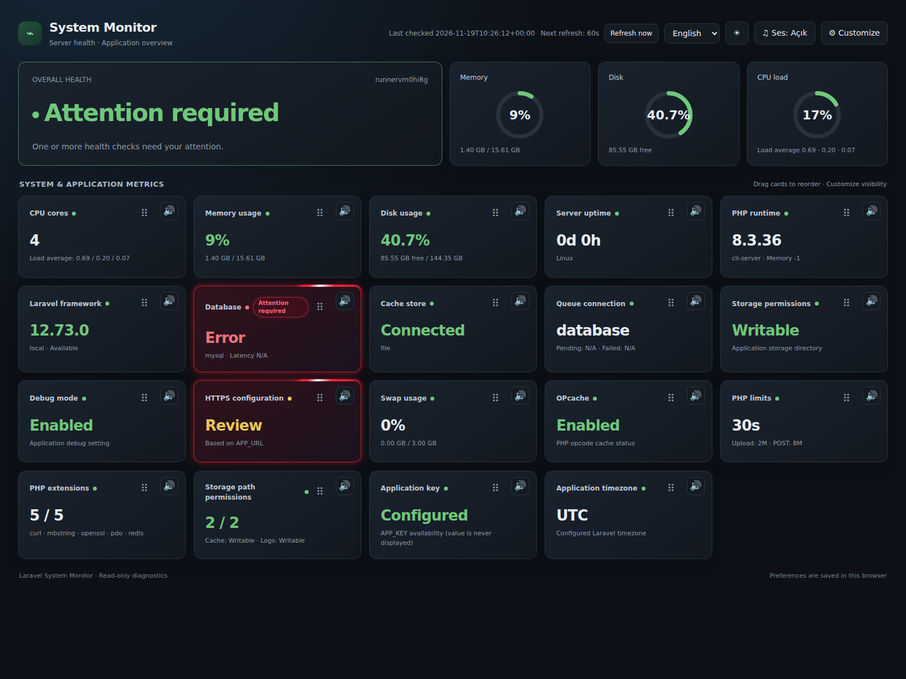

# Laravel System Monitor

[](https://packagist.org/packages/laravel-system-monitor)
[](https://packagist.org/packages/laravel-system-monitor)
[](https://packagist.org/packages/laravel-system-monitor)
[](https://laravel.com)
[](https://github.com/mertaydin/laravel-system-monitor/actions/workflows/tests.yml)
[](LICENSE)


Laravel için hafif, framework ile yerel çalışan bir izleme paneli. Redis, Horizon, S3, Cloudflare R2 veya başka bir isteğe bağlı altyapı gerektirmeden sunucu kaynaklarını, çalışma zamanı servislerini ve uygulama sağlığını hızlıca görüntüleyin.

<p align="center">
  
</p>


## Özellikler

- **Sunucu özeti:** Hostname, işletim sistemi ailesi, çalışma süresi, CPU çekirdek sayısı ve load average.
- **Bellek ve disk:** Sunucunun sunduğu bilgilere göre RAM, swap ve uygulama dosya sistemi kullanımı.
- **PHP çalışma zamanı:** PHP sürümü, SAPI, bellek ve yükleme limitleri, OPcache ve seçili eklentilerin kullanılabilirliği.
- **Laravel uygulaması:** Framework sürümü, ortam, bakım modu ve storage izinleri.
- **Veritabanı:** Bağlantı durumu, sürücü ve hafif `SELECT 1` gecikme kontrolü.
- **Cache ve kuyruk:** Cache store sağlığı, kuyruk sürücüsü, veritabanı kuyruğu derinliği ve tablolar mevcutsa başarısız iş sayısı.
- **Temel güvenlik kontrolleri:** APP_KEY varlığı, debug modu ve APP_URL üzerinden HTTPS yapılandırması.
- **Özelleştirilebilir panel:** Metrik kartlarını ayrı ayrı gizleme/gösterme, sürükleyerek sıralama ve varsayılan düzene dönme.
- **Altı panel dili:** Tarayıcı oturum tercihiyle İngilizce, Türkçe, Arapça (RTL), İspanyolca, Hintçe ve Basitleştirilmiş Çince.
- **Koyu ve açık temalar:** Gece/gündüz görünümü; seçilen tema mevcut tarayıcıda hatırlanır.
- **İsteğe bağlı servis bağımlılığı yok:** Redis, Horizon, bulut depolama ve QR entegrasyonları gerekmez.
- **Düşük yük:** Collector anlık görüntü önbelleği varsayılan olarak etkindir.
- **Salt okunur:** Paket keyfi shell komutları çalıştırmaz veya uygulama verilerini değiştirmez.

## Gereksinimler

- PHP 8.2 veya üzeri
- Laravel 10, 11, 12 veya 13

## Kurulum

```bash
composer require mertaydin/laravel-system-monitor

php artisan vendor:publish --tag=system-monitor-config
php artisan vendor:publish --tag=system-monitor-assets --force
php artisan vendor:publish --tag=system-monitor-translations
```

Her paket güncellemesinden sonra en güncel JavaScript ve CSS dosyalarının yayımlanmış kopyaların üzerine yazılması için asset komutunu `--force` ile yeniden çalıştırın.

Service provider Laravel package discovery ile otomatik kaydedilir.

## Panel

Paneli açın:

```
/system-monitor
```

### Yetkilendirme

Uygulamanızın `AppServiceProvider` sınıfında bir yetkilendirme callback'i kaydedin. Erişime izin vermek için `true`, HTTP 403 yanıtı için `false` döndürün. Callback mevcut isteği alır.

```php
use Illuminate\Http\Request;
use MertAydin\SystemMonitor\Facades\SystemMonitor;

public function boot(): void
{
    SystemMonitor::auth(function (Request $request) {
        return $request->user()
            && $request->user()->hasRole('SuperAdmin');
    });
}
```

Callback, dil tercihi uç noktası dahil panel rotalarına uygulanır. Callback kaydedilmezse paket yapılandırılmış middleware davranışını korur (varsayılan `web` ve `auth`).

### Paneli kişiselleştirme

Kartları göstermek veya gizlemek için **Customize** seçeneğine tıklayın. Sıralarını değiştirmek için sürükleyip bırakın. Görünürlük ve sıralama tercihleri mevcut tarayıcıda local storage ile saklanır; kullanıcılar veya tarayıcılar arasında paylaşılmaz. Varsayılan düzene dönmek için **Reset layout** seçeneğini kullanın.

Dil seçicisinden Türkçe, İngilizce, Arapça, İspanyolca, Hintçe veya Basitleştirilmiş Çince seçin. Seçim kimliği doğrulanmış oturumda saklanır. Arapça sağdan sola düzen kullanır. Güneş/ay kontrolüyle koyu ve açık temalar arasında geçiş yapın; tema tarayıcıda yerel olarak saklanır.

## Yapılandırma

Yapılandırma dosyasını `config/system-monitor.php` konumuna yayımlayın:

```php
return [
    'enabled' => env('SYSTEM_MONITOR_ENABLED', true),
    'path' => env('SYSTEM_MONITOR_PATH', 'system-monitor'),
    'middleware' => ['web', 'auth'],
    'title' => env('SYSTEM_MONITOR_TITLE', 'System Monitor'),

    'cache' => [
        'enabled' => true,
        'store' => env('SYSTEM_MONITOR_CACHE_STORE'),
        'ttl' => 15,
    ],

    'collectors' => [
        'server' => true,
        'php' => true,
        'laravel' => true,
        'database' => true,
        'cache_queue' => true,
        'security' => true,
    ],
];
```

| Seçenek | Varsayılan | Açıklama |
| --- | --- | --- |
| `enabled` | `true` | Panel rotasını etkinleştirir veya kapatır. |
| `path` | `system-monitor` | Panel URL öneki. |
| `middleware` | `['web', 'auth']` | Rota middleware'i. İsteğe bağlı `SystemMonitor::auth()` callback'i uygulamaya özel yetkilendirme ekler. |
| `title` | `System Monitor` | Panel başlığı. |
| `cache.enabled` | `true` | Collector anlık görüntülerinin önbelleğe alınmasını etkinleştirir. |
| `cache.store` | Varsayılan cache | İsteğe bağlı Laravel cache store adı. |
| `cache.ttl` | `15` | Anlık görüntü ömrü (saniye). |
| `collectors.*` | `true` | Collector gruplarını ayrı ayrı etkinleştirir veya kapatır. |

Panel URL'sini ve başlığını `.env` üzerinden değiştirebilirsiniz:

```dotenv
SYSTEM_MONITOR_PATH=system-monitor
SYSTEM_MONITOR_TITLE="System Monitor"
SYSTEM_MONITOR_ENABLED=true
```

## Uyarı sesi tercihleri

Sağlıksız metrik kartları ses ayarlarından bağımsız olarak animasyonlu kırmızı neon kenarlık alır. Panel sesini genel olarak veya kart bazında susturabilirsiniz; sesi kapatmak görsel sağlık uyarısını gizlemez. Ses tercihleri tarayıcı sekmesi başına saklanır.

Panel otomatik yenileme aralıklarını ve manuel yenileme işlemini destekler. Sunucu tarafındaki metrik toplama sürecini değiştirmeden kart görünürlüğü ve sıralaması özelleştirilebilir.

## Metrik kullanılabilirliği

Bazı işletim sistemi metrikleri platforma bağlıdır. Linux bellek, swap ve uptime değerleri `/proc` üzerinden okunur; desteklenmeyen değerler `null`/N/A döndürür. CPU load average `sys_getloadavg()` fonksiyonuna bağlıdır. Disk kullanımı Laravel uygulamasının bulunduğu dosya sistemini ifade eder.

Kuyruk derinliği yalnızca Laravel database queue sürücüsünde raporlanır. `failed_jobs` tablosu varsa başarısız iş sayısı gösterilir. Diğer kuyruk sürücüleri tanımlanır ancak bu ilk sürümde arka uca özel kuyruk derinliği sorgulanmaz.

## Güvenlik

- Panel varsayılan olarak `web` ve `auth` middleware'leriyle korunur ve istek sınırlaması uygular.
- Uygulamaya özel yönetici middleware'i veya ağ kısıtlaması ekleyin. Ayrıcalıklı operasyonel veriler için yalnızca kimlik doğrulama yeterli olmayabilir.
- Paneli herkese açık şekilde sunmayın.
- Paket ortam sırlarını göstermez ve shell komutu çalıştırmaz.
- Veritabanı bağlantısı salt okunur `SELECT 1` sorgusuyla kontrol edilir.

## Uyumluluk

| Laravel | PHP |
| --- | --- |
| 10 | 8.2+ |
| 11 | 8.2+ |
| 12 | 8.2+ |
| 13 | 8.3+ |

## Geliştirme

```bash
composer install
composer test
composer format
```

## Lisans

[LICENSE](LICENSE) dosyasına bakın. MIT.

## Dokümantasyon ve destek

- [Değişiklik günlüğü](CHANGELOG.md)
- [GitHub sürümleri](https://github.com/mertaydin/laravel-system-monitor/releases)
- [Hata bildir / özellik iste](https://github.com/mertaydin/laravel-system-monitor/issues)
